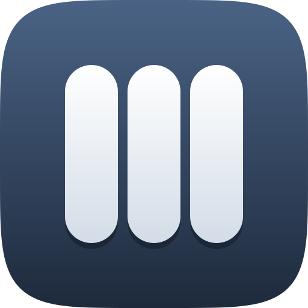

<div align="center">
  
  <h1>GlyphStudio</h1>
  <h3>Every SF Symbol. Right on your desktop.</h3>
  <p>Browse more than 7,000 symbols, then build with them in Compose.</p>
  <p>
    <a href="https://github.com/bxanedot/GlyphStudio/releases/latest"><strong>Download for macOS, Windows and Linux</strong></a>
    &nbsp;·&nbsp;
    <a href="#build-with-compose"><strong>Use the Compose library</strong></a>
  </p>
  <a href="https://github.com/bxanedot/GlyphStudio/releases/latest"></a>
</div>

<br />

### Find the right symbol. Fast.
Search understands typos and everyday words, so “garbage” finds `trash` and “cog” finds `gearshape`. Browse by category, switch between dualtone and monochrome, and save favorites.

### Feels right at home.
GlyphStudio follows your system’s light or dark appearance, and its sidebar and inspector use Liquid Glass.

### From symbol to code in one click.
Pick a colour and background, then copy the symbol’s name or a complete, ready-to-paste Compose snippet.

### Built for coding agents.
GlyphStudio is also an MCP server. Point your AI agent at the installed app and it can search every symbol and get the exact Compose import. Nothing extra to install.

<br />

## Download

| macOS | Windows | Linux |
| :---: | :---: | :---: |
| [`.dmg`](https://github.com/bxanedot/GlyphStudio/releases/latest) | [`.msi`](https://github.com/bxanedot/GlyphStudio/releases/latest) | [`.deb`](https://github.com/bxanedot/GlyphStudio/releases/latest) |

The macOS app isn’t signed yet. The first time you open it, Control-click the app and choose **Open**.

## Build with Compose

The `sfsymbols` library brings the same symbols to Jetpack Compose and Kotlin Multiplatform: Android, desktop, iOS and web. You can set weight, scale, colour and animation.

```kotlin
SfSymbolIcon(
    symbol = SfSymbol["heart.fill"],
    contentDescription = "Favorite",
    size = 24.dp,
    weight = SfWeight.Semibold,
)
```

To add it to your project, see the [installation guide](docs/INSTALLATION.md). Then read the [usage guide](docs/USAGE.md) and the [animation guide](docs/ANIMATION.md).

## Connect an AI agent

Add this to your agent’s MCP settings. **Settings → MCP** in the app shows it with your exact install path.

```json
{ "mcpServers": { "glyphstudio": { "command": "/Applications/GlyphStudio.app/Contents/MacOS/GlyphStudio", "args": ["--mcp"] } } }
```

The default path on Windows is `%LOCALAPPDATA%\GlyphStudio\GlyphStudio.exe`, and on Linux it’s `/opt/glyphstudio/bin/GlyphStudio`. Agents working on this repo should read [AGENTS.md](AGENTS.md).

## Build from source

You need JDK 21 or newer.

```sh
./gradlew :app:run          # run the app (on Windows: gradlew.bat)
./gradlew :app:jvmTest      # run the app tests
```

| Folder | Contents |
| --- | --- |
| `app/` | The GlyphStudio desktop app |
| `sfsymbols/` | The Compose Multiplatform symbol library |
| `docs/` | Library guides |
| `scripts/` | Icon rendering and MCP test tools |

<br />

<sub>GlyphStudio is an independent project, not affiliated with Apple. SF Symbols are Apple’s property. Follow Apple’s <a href="https://developer.apple.com/design/human-interface-guidelines/sf-symbols/">SF Symbols terms</a>, and don’t use the symbols in app icons, logos or other trademark use. Released under the <a href="LICENSE">Apache License 2.0</a>. Made by <a href="https://github.com/bxanedot">bxane</a>.</sub>
